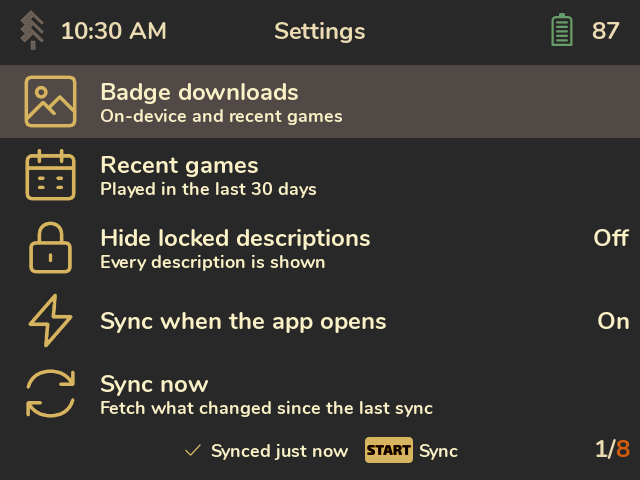

# Settings

| Setting | What it does |
|---|---|
| **Hide locked descriptions** | Spoiler protection. **Off** (default): every description is shown. **Story only**: hides locked achievements tagged *Progression* or *Win condition*, the story beats and the ending. **All**: hides every locked one. Press X on an achievement to reveal it anyway. |
| **Sync when the app opens** | On (default) or off. Off means syncs only run when you press Start. |
| **RAOfflineProxy** | Shown only when the proxy is installed: whether it's on, online, how many unlocks wait to sync, how many games it has cached. Press A for an explanation. See [Sync and offline play](Sync-and-Offline-Play.md). |
| **Sync now** | Same as pressing Start. |
| **Download every game** | Downloads achievements and badges for your entire library for offline use. It resumes in later syncs until finished. While it is pending, this row reads **Stop downloading every game**. |
| **Web API key** | Shows the end of the current key; press A to enter a new one. |
| **Clear image cache** | Deletes downloaded badges and icons (shows how much space they use). They download again when needed. |

Find the installed Cheevos version in Spruce **Settings → About this device**.

Normal syncs download achievements and badges for on-device games and games with play or unlock
activity in the last 30 days. They also download badges for Recent unlocks, even when an unlock's
full achievement set is outside that window.

**A note on "Story only":** RetroAchievements has no spoiler flag. "Story only" relies on the type
tags set developers add (Progression, Win condition, Missable). Tagging started in 2023, so many
older sets have no tags, and "Story only" hides nothing there. Use **All** for those games.

Settings take effect immediately and are saved in `Saves/cheevos/settings.json` when you exit
Cheevos, only if they changed. The file also remembers the Games progress/details view, the
achievement list/grid view and sort (shared by all games), and the Awards view (carousel, grid
or list). A power cut or forced kill before exit
loses changes from that session. Older settings files work as usual: missing settings use their
defaults, and unknown fields are ignored.
