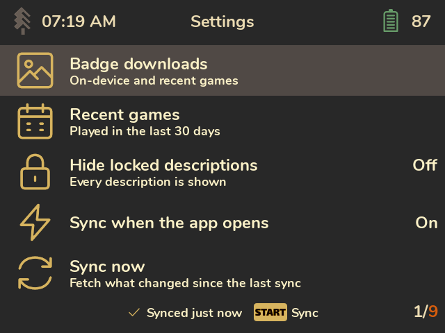

# Settings

| Setting | What it does |
|---|---|
| **Badge downloads** | Which badges a sync downloads ahead of time, so they're there offline. **On-device and recent games** (default): games Spruce recognised on the SD card, plus games played recently. **All games**: every game whose achievements are downloaded; takes more space. **Only while browsing**: nothing ahead of time; badges load when you open a game online. |
| **Recent games** | What "recently" means: 7, 30 (default) or 90 days. Every sync keeps the achievements of games played this recently, and badge downloads use it too. |
| **Hide locked descriptions** | Spoiler protection. **Off** (default): every description is shown. **Story only**: hides locked achievements tagged *Progression* or *Win condition*, the story beats and the ending. **All**: hides every locked one. Press X on an achievement to reveal it anyway. |
| **Sync when the app opens** | On (default) or off. Off means syncs only run when you press Start. |
| **RAOfflineProxy** | Shown only when the proxy is installed: whether it's on, online, how many unlocks wait to sync, how many games it has cached. Press A for an explanation. See [Sync and offline play](Sync-and-Offline-Play.md). |
| **Sync now** | Same as pressing Start. |
| **Download every game** | Downloads every game's achievements, for offline use: downloads are spaced about 3 seconds apart. It carries on in later syncs until it's done; meanwhile this row reads **Stop downloading every game**. |
| **Web API key** | Shows the end of the current key; press A to enter a new one. |
| **Clear image cache** | Deletes downloaded badges and icons (shows how much space they use). They download again when needed. |
| **About** | Version, license and credits. |

Both **On-device and recent games** and **All games** also download the badges shown in
Recent unlocks, even for games whose full achievement lists aren't downloaded.

**A note on "Story only":** RetroAchievements has no spoiler flag. "Story only" relies on the type
tags set developers add (Progression, Win condition, Missable). Tagging started in 2023, so many
older sets have no tags, and "Story only" hides nothing there. Use **All** for those games.

Settings take effect immediately and are saved in `Saves/cheevos/settings.json` when you exit
Cheevos, only if they changed. The file also remembers the Games progress/details view and the
achievement list/grid view (shared by all games). A power cut or forced kill before exit loses
changes from that session. Older settings files work as usual: missing settings use their
defaults, and unknown fields are ignored.
