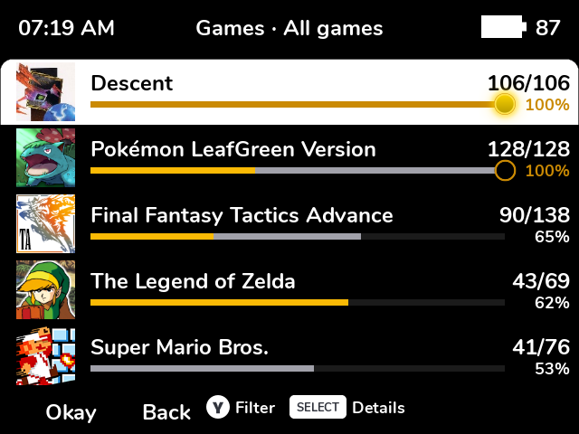
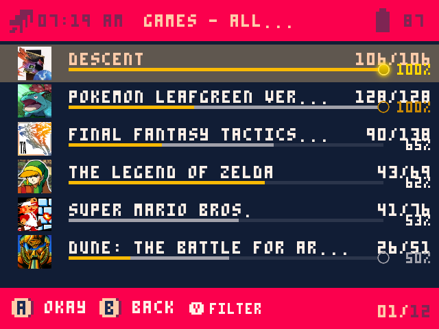
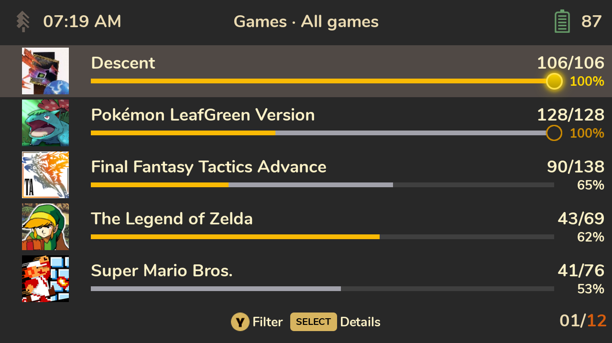

# Themes and devices

## Themes
Cheevos is drawn with Spruce's own UI toolkit, so it uses your theme's fonts, colours,
backgrounds, highlight and button badges. Progress bars and award markers use
RetroAchievements' gold and silver where they're readable on your theme, and the theme's own text
colour where they aren't (on a yellow theme, for example).

| SPRUCE | MINIMAL | Pico-8 |
|---|---|---|
|  |  |  |

Themes with their own button hints in the bottom bar ("A Okay B Back") keep them; Cheevos adds
its hints after them. Theme fonts don't have emoji, so emoji in rich presence texts are left out.
Some pixel fonts lack accented letters; Cheevos then shows the plain letter ("Pokemon").

## Resolutions
Every resolution Spruce's default theme supports is laid out properly: 640×480, 720×480,
752×560, 720×720, 960×720, 1024×768, 1280×720 and 480×800. Icons are drawn at whole-pixel sizes
so the pixel art stays sharp.

## Devices
Cheevos supports **every device supported by SpruceOS**. It uses Spruce's own UI toolkit and
the same launcher settings Spruce uses for its UI on each platform.
